# PlayGraph

[](https://github.com/JakeeUp/playgraph/actions/workflows/security.yml)

Letterboxd for games, with receipts.

Connect Steam and PlayGraph imports your playtime and achievements. When that
data is available, your review keeps a snapshot of it. Two hundred hours or
twenty minutes, there's some context behind the take.

**[Try the demo](https://jakeeup.github.io/playgraph/).** It's the real front
end running on sample data in your browser, so click around, rate things and
write reviews. Nothing you do there is saved or sent anywhere. Sign-in, Steam
sync and the news feed are stand-ins.

I'm building it around that idea: a place to keep your games and reviews
together, with your play history alongside them.

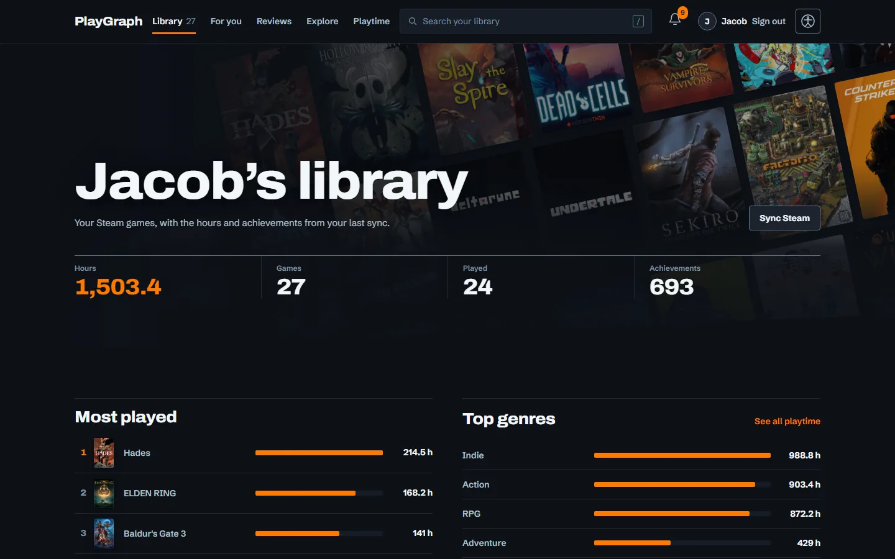

## What it does

- Steam sign-in, plus PlayGraph accounts through Clerk
- Full library sync in the background, including achievements
- PlayStation trophies and PS4/PS5 hours from your public PSN profile, kept on their own shelf
- Cover art, summaries, release dates and platforms from IGDB
- Playtime by genre, with apps like Wallpaper Engine kept out of your game stats
- Drag half-star ratings, plus verified hours and achievements when available
- Comments, a public feed, and a For You feed ranked by your library and genres
- Likes, reposts, quote reviews and private bookmarks
- Trending games and reviews on Explore, plus players to follow
- Notifications for likes, replies, reposts and follows, kept for 90 days
- Profiles with a game room, and a private Year in Review
- Settings to pause motion, raise contrast, or turn off slash-to-search
- Game pages with community reviews, your review, and shareable links
- Edit or delete your own reviews without changing their original playtime snapshot

| Your games | Reviews and news |
|---|---|
| 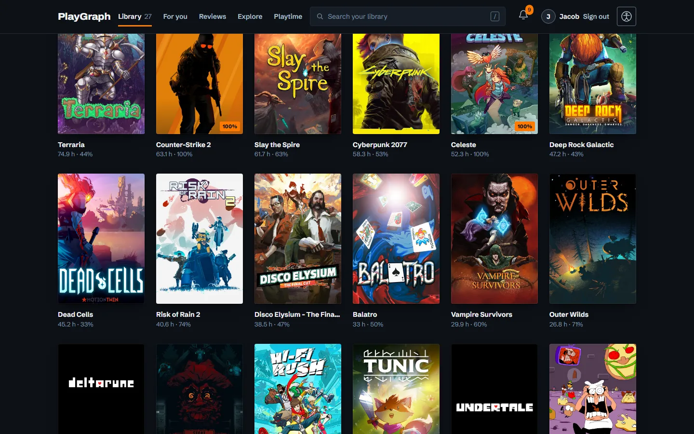 | 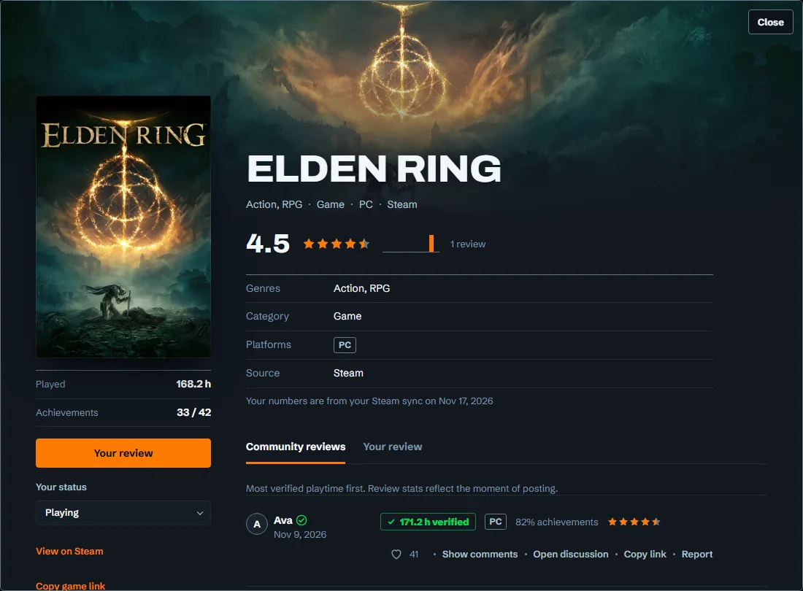 |
| Hours on each game; finished ones get a 100% tag | Your hours and achievements next to the reviews |
| 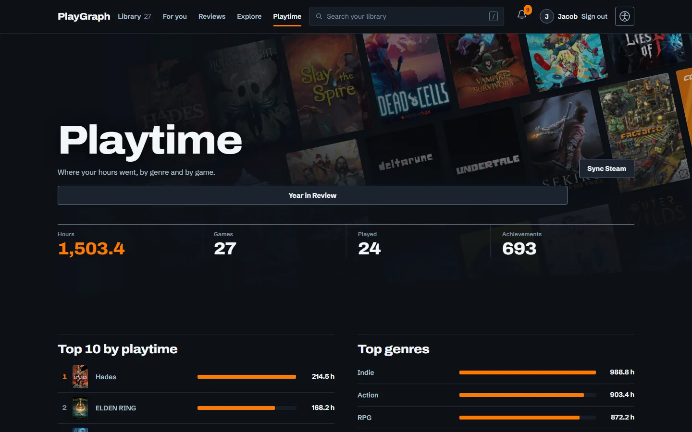 | 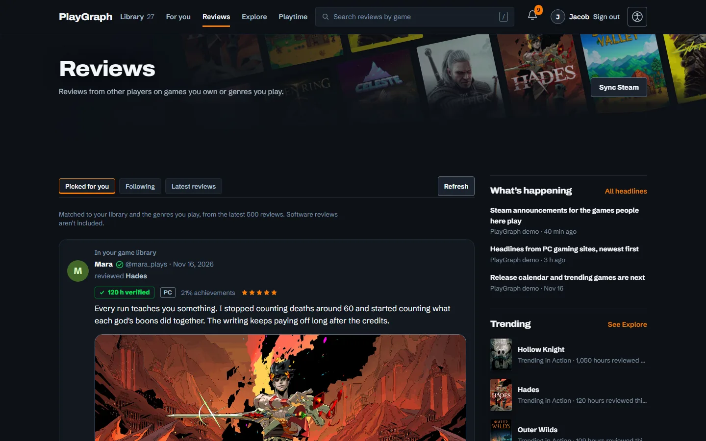 |
| Where the hours went, by genre and by game | A feed of reviews with verified hours, plus headlines and trends |
| 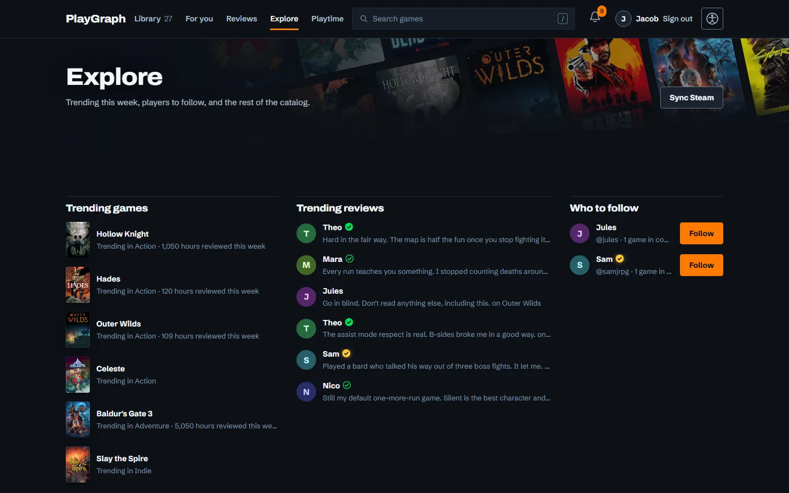 | 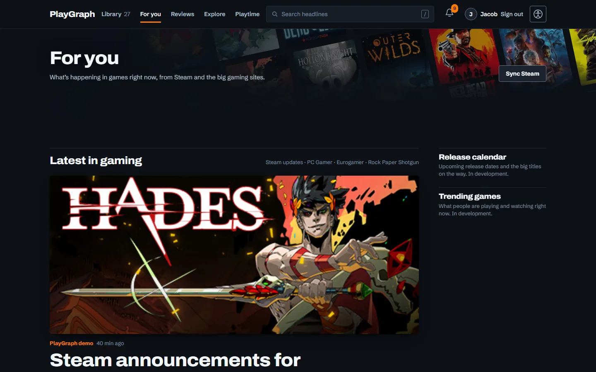 |
| Trending this week, and players to follow | Game news from Steam and the big gaming sites |
| 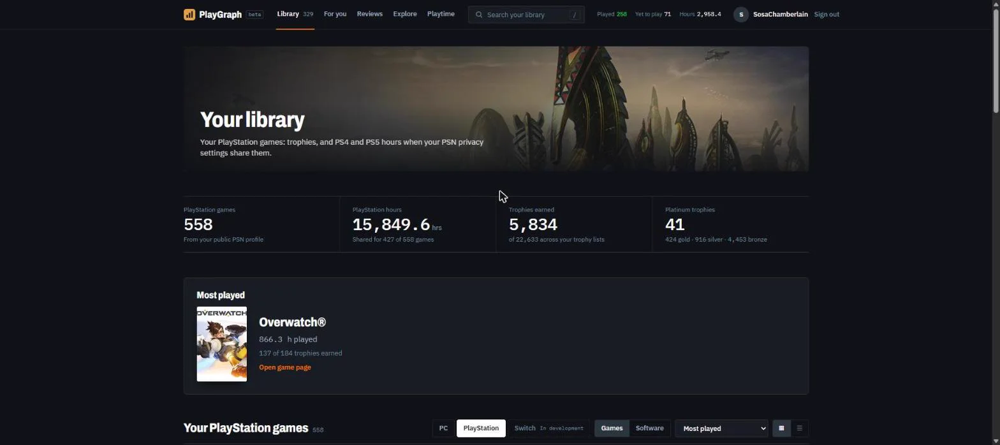 | 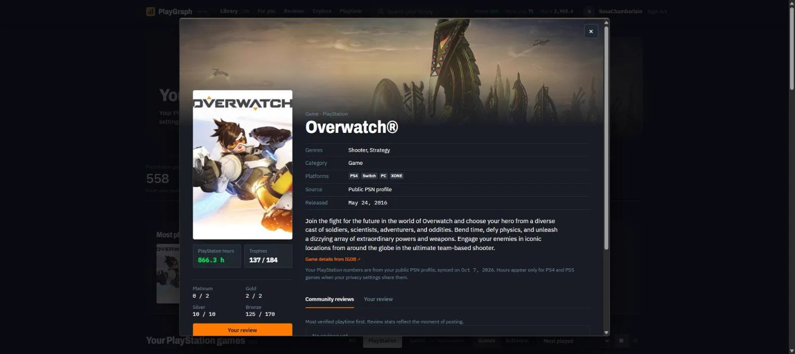 |
| Your PlayStation games, hours and trophies, never mixed with Steam | Trophy breakdown and game details from IGDB |
| 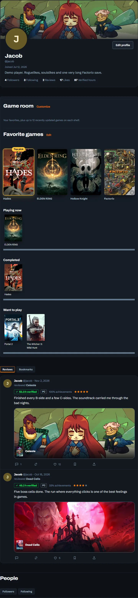 | 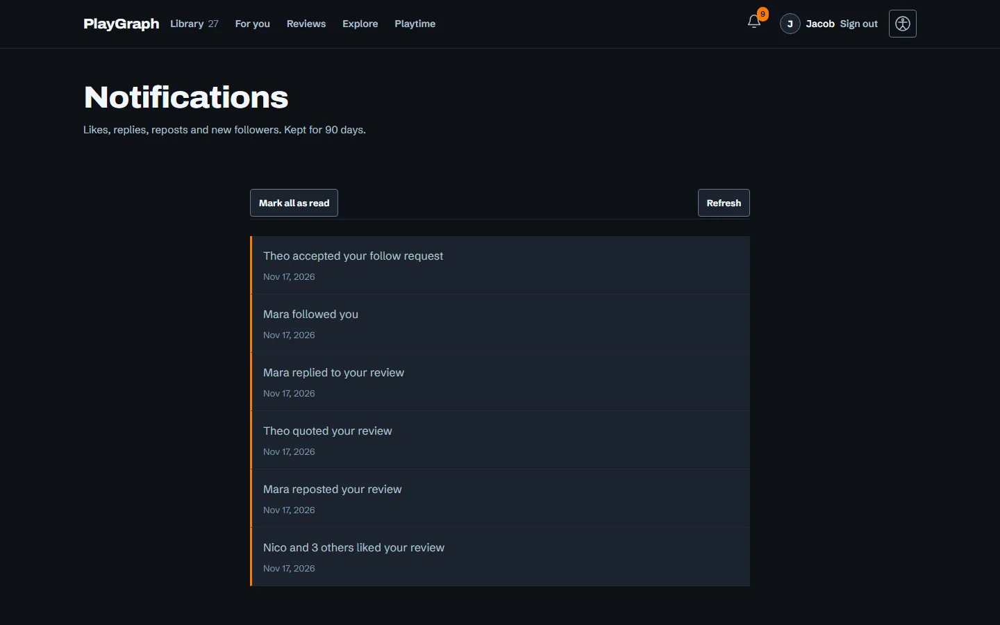 |
| Favorites and shelves on a profile | Likes, replies, reposts and follows, kept for 90 days |
| 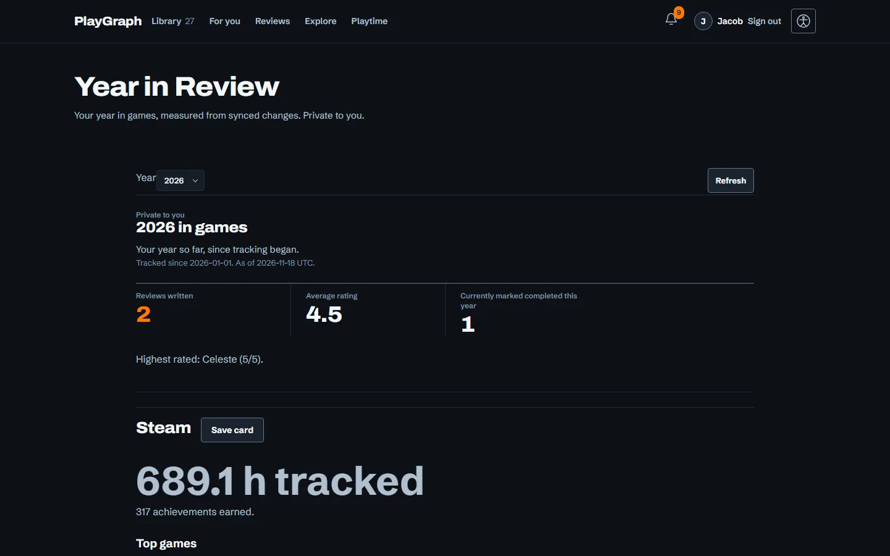 | 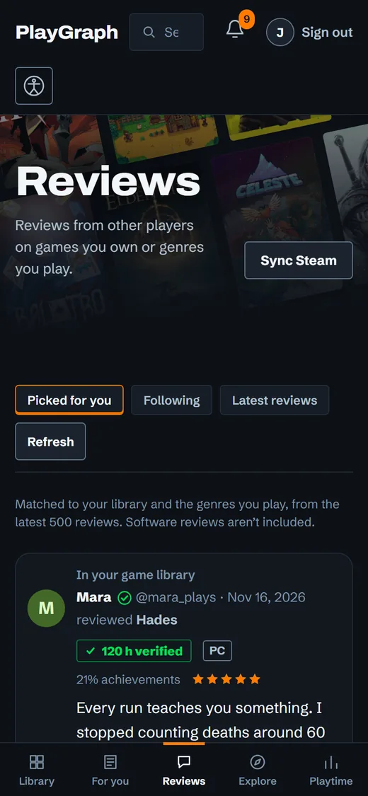 |
| Hours and reviews for the year, private to you | The same feed, with the bottom navigation |

Accessibility settings stay in this browser.

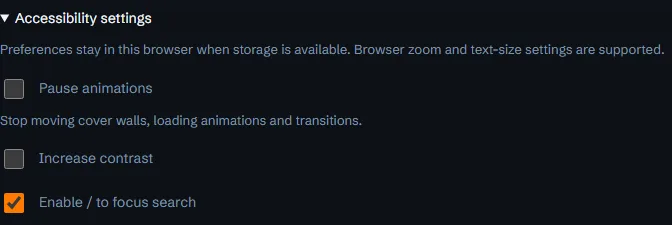

Sign-in runs through Clerk. Once you're in, the account page lets you connect
Steam. This is the development build; the email address is obscured in the
screenshot.

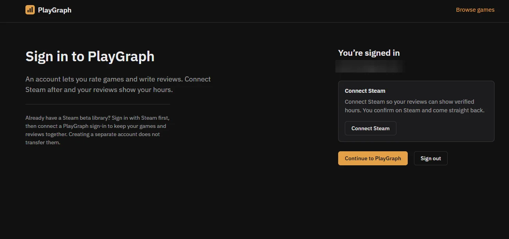

Existing Steam beta users can connect a PlayGraph sign-in from the account page
and keep their library and reviews. Creating a separate account doesn't transfer
them, and merging two existing accounts isn't supported. The connection flow is
still in local testing.

## How it works

- **Verified hours are frozen.** A review saves the latest synced Steam hours
  and achievement progress available when you publish. Those values come from
  append-only snapshots; editing a review doesn't refresh them.
- **Steam login is checked with Steam.** The server verifies OpenID 2.0
  callbacks with Steam before issuing a session.
- **Syncs run as jobs.** Achievements are one API call per game, so a big
  library takes minutes. `POST /me/sync` queues it on arq and the UI polls.
- **Sessions are checked server-side.** Redis holds revocation and rate-limit
  state. Protected requests fail closed if it's unavailable. Browser writes
  also require a session-bound CSRF token and a matching Origin.
- **Rate limits use a sliding window** in a Lua script, so nobody gets a double
  budget at a window edge.
- **Public reads are cached** with generational invalidation, and concurrent
  misses share one query. Writes invalidate the cache; short TTLs limit stale
  reads if invalidation fails. Private library responses aren't cached.

## Measured

Recorded local development runs: SQLite, 3,000 games, 8,000 reviews and 200
simulated visitors browsing public pages. These are successive optimization
runs, not production capacity estimates. p95 is the response time that 95% of
requests finished within.

| Setup | p95 | Throughput |
|---|---|---|
| Cache off, before the query fix | 49 s | 3.9 req/s |
| Cache off, after the query fix | 94 ms | 82 req/s |
| Cache on, with miss coalescing | 41 ms | 84 req/s |

The changes were storing each title's game/software classification in the
database and having concurrent cache misses share a query. The simulated
visitors pause between requests, so these runs don't establish maximum
throughput. Signed-in traffic and hosted performance still need measurement.

## Stack

FastAPI, SQLAlchemy 2, Alembic, and arq on Redis. SQLite locally; Postgres is the
planned deployment database. The frontend is plain ES modules served by FastAPI,
with no build step.

## Run it locally

Use Python 3.14, the version used in development and CI, and a local or hosted
Redis instance. Run these commands from the repository root.

```powershell
python -m venv .venv
.\.venv\Scripts\Activate.ps1
python -m pip install -r requirements.txt
Copy-Item .env.example .env
```

On macOS/Linux, activate with `source .venv/bin/activate` and copy the config
with `cp .env.example .env`. If you already have a `.env`, keep it.

In `.env`, add a [Steam Web API key](https://steamcommunity.com/dev/apikey),
your Redis URL, and a signing secret:

```bash
python -c "import secrets; print(secrets.token_hex(32))"
```

With the API and worker stopped, apply migrations:

```bash
python -m app.migrations upgrade
```

Start the API:

```bash
python -m uvicorn app.main:app
```

In a second terminal, activate the same environment and start the sync worker:

```bash
python -m arq app.worker.WorkerSettings
```

Open [localhost:8000/app](http://localhost:8000/app). On Windows,
`scripts\dev.bat` starts both processes. Stop each with Ctrl+C in its terminal
before migrating.

PlayGraph accounts are optional. To turn them on, put your Clerk development keys
in `.env.clerk` as `CLERK_PUBLISHABLE_KEY` and `CLERK_SECRET_KEY`, and set
`CLERK_ENABLED=true` in `.env`. Restart the API, then open `/account`.
Keep both environment files out of Git.

### The demo site

The demo is built from `app/static` with a stand-in API and sample data from
`demo/sample_data.py`. It needs nothing beyond Python:

```bash
python demo/build.py _site
python -m http.server -d _site 8800
```

GitHub Pages publishes it from `main` through `.github/workflows/demo.yml`.

### A larger game catalog

The public catalog is separate from player libraries, reviews and verified hours.
After a backed-up migration through `0017_catalog_sync`, an operator can set
`IGDB_CATALOG_SYNC_ENABLED=true` alongside the existing IGDB credentials and
restart the worker. It is off by default and never runs in demo mode.

The single worker imports up to five 500-game pages per minute, using exact
IGDB and Steam identities. Each page commits its metadata and cursor together.
Interrupted jobs resume from that cursor. Existing store conflicts become
review proposals, never automatic merges. No users or activity are fabricated.

After the initial scan, six-hourly windows fetch new and changed eligible games.
The same main-game, remake, remaster, expanded-game and port filters as search
exclude DLC and editions. Metadata is stored locally; images stay on provider
CDNs. SQLite imports stop before free disk space falls below 256 MiB.

```bash
python -m app.catalog_sync --status
python -m app.catalog_sync
```

The second command queues one bounded batch rather than bypassing the worker.
Explore uses title cursors, so browsing can continue past 100,000 games without
raising public offset limits. This does not replace the reviewed store-merge
workflow or remove games when the provider deletes or reclassifies them.
Keep the existing IGDB attribution and commercial-partnership launch gate.

## Tests

Node.js is needed for the browser-module checks.

```bash
python -m pytest -q
node --test tests/*.mjs
```

CI runs both, plus `pip-audit` and `bandit`, on every push. There's also a
Locust load test in `loadtest/`, and the file explains how to run it.

## Status

Personal project, actively being built, not deployed yet.

Next up is finishing account-linking acceptance, Steam connections for new
PlayGraph accounts, and recovery controls. After that: a cross-platform catalog through IGDB, want-to-play and
diary tracking, privacy controls, then public profiles.

No license yet, so all rights reserved for now.
